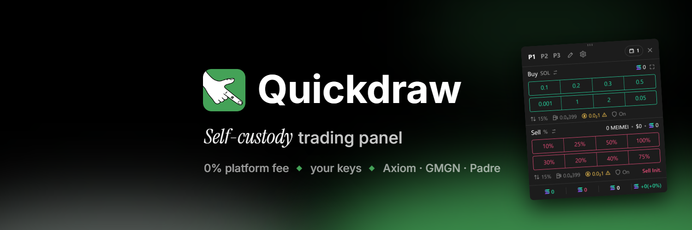
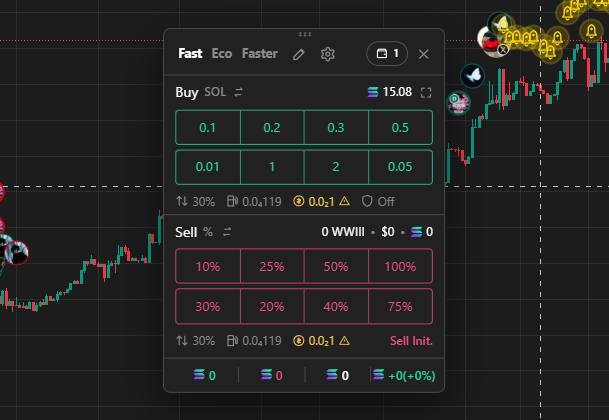

<p align="center"></p>

<p align="center">
  <b>A self-custody, one-click trading panel for Solana memecoin terminals.</b><br>
  Your keys. Your RPC. 0% platform fee. Open source.
</p>

<p align="center">
  <a href="https://github.com/UseQuickdraw/quickdraw/actions/workflows/ci.yml"></a>
  <a href="https://github.com/UseQuickdraw/quickdraw/releases"></a>
  <a href="LICENSE"></a>
</p>

<p align="center">
  <a href="#install">Install</a> ·
  <a href="#getting-started">Getting started</a> ·
  <a href="#the-panel">The panel</a> ·
  <a href="docs/how-it-works.md">How it works</a> ·
  <a href="SECURITY.md">Security</a>
</p>

---

Quickdraw sits on top of **Axiom**, **GMGN** and **Padre** and trades the coin on screen with one click. It builds, signs and sends every swap itself, in your browser, from your own burner wallet, through your own RPC. There's no server, no account, no telemetry and **no platform fee**.

<p align="center"></p>

> [!WARNING]
> Use at your own risk. This is not financial advice, and memecoins often go to zero. Trades fire on one click with no confirmation. **Only ever use a burner wallet** holding what you can afford to lose. Never import your main wallet.

## Why Quickdraw

- **0% platform fee.** You pay the network, the pool and an optional landing tip. Nothing goes to us; the panel even shows what a 1% fee would have cost you.
- **Self-custody.** The key is generated and sealed in your browser and never leaves it. Trades are signed locally.
- **Your connections.** Quotes, sends and confirmations go straight to the RPC and sender you choose. No middleman API, no Jupiter API.
- **Fast.** Market state is kept live over WebSocket, so a click quotes and builds with no network round-trip, then lands through Helius Sender with automatic rebroadcasts.
- **Guarded.** Every transaction is checked against a strict allowlist before it's signed (see [SECURITY.md](SECURITY.md)).
- **Open source.** MIT licensed, reproducible release builds, pinned dependencies.

## Features

- One-click buys and sells with presets, in **Fast** or **Eco** landing tiers, and three switchable fee profiles.
- Sell by %, by SOL amount, or **Sell Init.** to take out exactly what you put in.
- Live position and PnL per coin, in SOL or USD, with a ledger you can export as CSV.
- Several wallets at once: every click trades from each selected wallet.
- Hotkeys, per-button fee overrides, and a sweep to your main wallet.
- Fully adjustable look: rows, button shape, colours, a background image, pop-up position and duration, sounds.
- Dry run mode that simulates every trade on chain without sending it.

**Markets:** pump.fun curves and PumpSwap, Raydium LaunchLab (letsbonk.fun, stonk.fun…) and CPMM, Raydium CLMM and Orca Whirlpool pools, coins with a Token-2022 transfer fee, and coins priced in another token (STONK, an xStock, USDC, another pump coin), routed through SOL in one transaction. See [supported markets](docs/how-it-works.md#supported-markets).

## Install

### From a release

1. Download `quickdraw-<version>-chrome.zip` and its `.sha256` from [Releases](https://github.com/UseQuickdraw/quickdraw/releases).
2. Check the checksum (see [verifying a release](docs/development.md#verifying-a-release)).
3. Unzip it, open `chrome://extensions`, turn on **Developer mode**, click **Load unpacked** and pick the unzipped folder.

Works in Chrome, Brave, Edge and other Chromium browsers.

### From source

```bash
npm ci
```

```bash
npm run build
```

Then load `.output/chrome-mv3` as an unpacked extension.

## Getting started

The options page opens on install and walks you through:

1. **A burner wallet.** Generate one (recommended) or import one made just for this. Back up its key; an optional backup file is encrypted with a password you pick.
2. **Your endpoints.** An RPC and WebSocket URL from a provider such as Helius, QuickNode or Triton (free tiers work), plus an optional Helius Sender key. Paste a Helius key and the rest fills in. The public `api.mainnet-beta.solana.com` can't be used: it refuses browser extensions.
3. **A starting profile:** Default, Sniping or Swing.

Want to look first? **Skip setup — preview the panel** shows what every click would do, with no wallet or RPC.

**Dry run is on by default:** each click builds and signs the real transaction, then only simulates it. When dry runs look right, fund the burner with a little SOL (0.05–0.1), turn off **Settings → Safety → Dry run**, and start with tiny trades.

## The panel

On Axiom a **Quickdraw** button sits next to the Instant Trade buttons; elsewhere a closed panel becomes a small pill. Drag the panel by its header, resize it from the edges, and it remembers where it was on each site.

| Control | What it does |
|---|---|
| **P1 / P2 / P3** | Switch fee profile (rename them on the Fees page) |
| ✎ | Edit button amounts in place; Enter saves, Escape cancels |
| ⚙ | Options |
| Wallet pill | How many wallets will trade; click to pick. The colour shows dry run or live. |
| Fee row | Tier, slippage, priority fee, tip and MEV protection; click to edit |
| Sell ⇄ | Sell buttons as % of your holding or as SOL amounts |
| **Sell Init.** | Sell just enough to recover what you put in; the rest rides |
| Footer | Bought · sold · holding · PnL; click for SOL or USD |

Pop-ups show each trade as it goes: sent, then what you got, with how long it took to reach a block and to confirm. Click one to dismiss it, hover to keep it.

### Make it yours

**Settings → Display** covers the look: 1–3 rows of buy and sell buttons, sell buttons as % / SOL / both, square or rounded buttons, theme, accent and panel colour, a background image, opacity, scale, which lines show, and where trade pop-ups appear, for how long, how many at once and with what sound. **Fees** holds each profile's tiers and per-button overrides, **Settings** the safety caps and hotkeys. Settings export and import as JSON, never including keys or endpoints.

## Fees

What a trade costs:

- the pool or curve's own fee, and the coin's transfer tax if it has one;
- the Solana network fee and your priority fee (capped in settings);
- the landing tip: **Fast** from 0.001 SOL, **Eco** from 0.000005 SOL. Small buys use Eco automatically, since a fixed tip is a big share of a small trade.

What you don't pay: any platform cut. If a developer fee is ever added it will be opt-in, off by default and shown in the panel.

## Troubleshooting

| Symptom | Fix |
|---|---|
| "Manifest file is missing or unreadable" | Load the folder that contains `manifest.json`: `.output/chrome-mv3`, or the unzipped release. |
| "403 Access forbidden" on endpoints | `api.mainnet-beta.solana.com` blocks extensions. Use a provider URL such as Helius. |
| "Couldn't find the token for this bonding curve" | Your RPC refuses `getTokenAccountsByOwner`. Use one that allows it, such as Helius. |
| Dry run: "The wallet has no SOL yet" | Expected for a new burner: send it a little SOL. |
| "429 Too Many Requests" | Your RPC is rate-limiting. Quickdraw retries for you; if it keeps happening, your plan's limit is too low for how fast you trade. |
| No Quickdraw button on Axiom | Axiom changed its page. The panel still works; please [open an issue](https://github.com/UseQuickdraw/quickdraw/issues/new/choose) with a screenshot. |
| A coin says it isn't supported | [Tell us about it](https://github.com/UseQuickdraw/quickdraw/issues/new/choose) with the token address. |

## Learn more

- [How it works](docs/how-it-works.md): markets and routing, sending and confirmation, positions and PnL.
- [Development](docs/development.md): building, tests against mainnet, adding a site or a market, verifying a release.
- [Security](SECURITY.md): the threat model, and how to report a vulnerability.
- [Contributing](CONTRIBUTING.md)

## License

[MIT](LICENSE)
